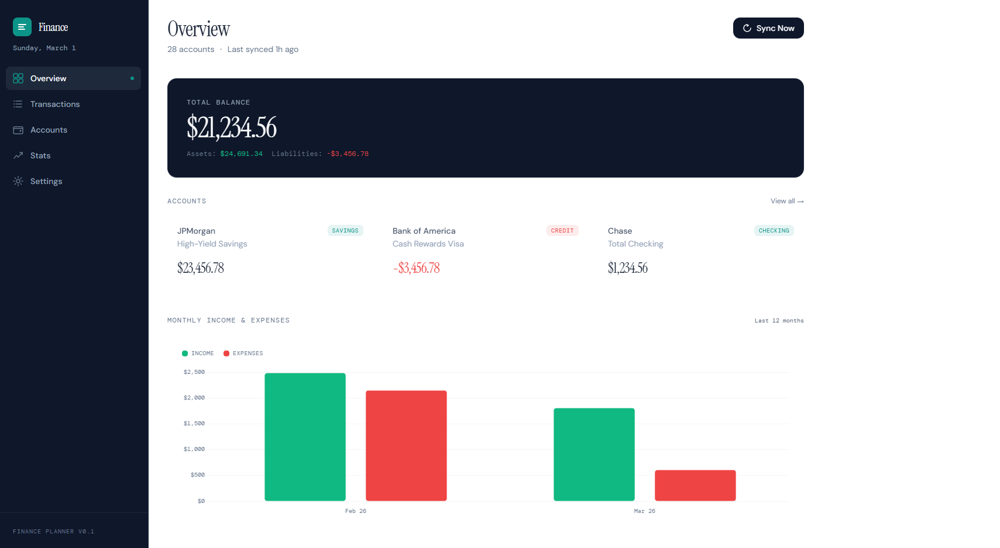

# Finance Planner

A personal finance app that syncs accounts from multiple providers as background tasks, relays 2FA challenges to the browser in real time, and auto-categorizes transactions using an LLM with a learning memory system.



## Architecture

The backend is async Python (FastAPI + SQLAlchemy 2.0) with a Vue 3 frontend. Syncs run as decoupled background tasks so the HTTP layer never blocks on provider I/O.

### Background Sync with 2FA Relay

Sync requests return **202 immediately** with a `SyncLog` ID. The actual work runs in an `asyncio.Task` with its own DB session via `async_session_maker()` — fully decoupled from the request lifecycle. Per-provider `asyncio.Lock` prevents concurrent syncs to the same provider, returning 409 on conflict. Rate limits (24/day SimpleFIN, 4/day Nelnet) are enforced before task creation.

The interesting problem is 2FA. Browser-based providers (Nelnet) can hit a 2FA challenge mid-sync while running in a background task. The solution is an `asyncio.Event`-based relay in [`app/services/two_fa.py`](app/services/two_fa.py):

1. The background task's browser detects a 2FA page and calls `two_fa_handler(challenge)` — a typed callback (`TwoFAHandler = Callable[[TwoFAChallenge], Awaitable[str]]`) injected via the provider interface
2. The handler creates a `TwoFASession`, sets the `SyncLog` status to `awaiting_2fa`, and blocks on `Event.wait()` with a 10-minute timeout
3. The frontend polls `/sync/status`, detects the state change, and renders a `TwoFAModal`
4. User submits the code via `POST /sync/{id}/2fa` which calls `session.submit_code()`, setting the event
5. The background task resumes, fills in the code, and continues the login flow

Three retry attempts, timeout tracking, and session cleanup on task completion.

### Provider Abstraction

All providers implement `FinanceProvider` ([`app/providers/base.py`](app/providers/base.py)) — an ABC with `validate_credentials()` and `sync()`. The `sync()` method accepts an optional `TwoFAHandler`, which API providers ignore and browser providers use for the relay above. Providers return data only; they never touch the database.

Browser providers ([`app/providers/browser.py`](app/providers/browser.py)) add Playwright with stealth plugins and platform spoofing. On Linux (Docker), the browser context injects Windows user-agent strings and `Sec-CH-UA-Platform: "Windows"` headers to bypass Akamai's bot detection, which flags Linux platforms.

### Transaction Upserts

Upserts use SQLAlchemy's `insert().on_conflict_do_update()` with a deliberate field split: provider-controlled fields (`amount`, `description`, `posted_at`, `is_pending`) are overwritten on conflict, while user-managed fields (`category`, `tags`, `notes`) are preserved. This means user edits survive re-syncs without conflict resolution logic — the constraint boundary is the design.

## LLM-Powered Categorization

Transaction categorization uses a three-pass pipeline that minimizes LLM calls and improves with use.

### Pass 1: Deterministic Memory Matching

`apply_memory_rules()` in [`app/services/categorize.py`](app/services/categorize.py) normalizes transaction descriptions (strip trailing dates, reference numbers, collapse whitespace) and batch-lookups against the `CategoryMemory` table. Memory entries are scoped per `(normalized_pattern, account_id)`, so "PAYMENT" on a credit card can map to a different category than "PAYMENT" on a checking account. This pass is free and instant — no LLM call.

### Pass 2: LLM with Structured Output

Unmatched transactions go to Gemini via `generate_structured()` in [`app/clients/gemini.py`](app/clients/gemini.py). The client sends `response_mime_type="application/json"` with `response_schema=BatchCategorizationResponse` — a Pydantic model that Gemini constrains its output to. The response is validated with `model_validate_json()`, retrying up to 3 times on `ValidationError`.

The prompt ([`app/prompts/categorize.j2`](app/prompts/categorize.j2)) is a Jinja2 template that injects the user's category definitions and up to 50 recent memory entries as few-shot examples. This means the LLM sees the user's own correction history as context — "AMZN MKTP" on this account was previously categorized as "Shopping" — which improves accuracy on similar descriptions without fine-tuning.

Each transaction in the LLM response includes a confidence score. Only results above the configured threshold are applied; below-threshold results are marked "Unable to Categorize" with the score preserved for manual review.

### Pass 3: Result Caching

LLM categorizations are written to `CategoryMemory` with `INSERT ... ON CONFLICT DO NOTHING`. User corrections use `ON CONFLICT DO UPDATE`. This asymmetry means user corrections always win: if a user recategorizes a transaction, that correction overwrites any LLM-cached entry and is used for both future deterministic matching (pass 1) and as a few-shot example in the LLM prompt (pass 2).

### Feedback Loop

The system forms a closed loop: user correction → memory upsert → future deterministic match + LLM few-shot context → better categorization. New transactions from syncs are matched against memory automatically (no LLM during sync). Over time, the LLM handles fewer transactions as the memory covers more patterns.

## Analytics

- **Net worth history**: Walks backwards from current account balances using monthly income/expense deltas to reconstruct historical net worth, then projects forward using 3-month rolling averages. No snapshots stored — the history is derived from transaction data on each request.
- **Income projection**: Auto-detects recurring income from transaction patterns (matching frequency: weekly, biweekly, monthly) or falls back to 3-month average. Models compound growth with monthly contributions at S&P 500 return bands (4%/10%/14%).
- **Recurring bill detection**: Groups transactions by normalized description, identifies consistent cadence and amounts across a configurable lookback window.
- **Spending breakdown**: Category-level aggregation with support for excluded categories (transfers, internal moves) that don't distort spending totals.

## Project Structure

```
app/
  core/         # Config, database session factory, Fernet encryption
  clients/      # Pure HTTP clients (SimpleFIN, Gemini) — no DB access
  providers/    # FinanceProvider ABC + implementations — no DB access, returns data only
  services/     # Business logic: sync orchestration, 2FA sessions, categorization
  routes/       # Thin HTTP handlers (sync, accounts, transactions, analytics, LLM)
  prompts/      # Jinja2 templates for LLM prompts
frontend/src/
  stores/       # Pinia stores (accounts, transactions, sync polling, categories)
  components/   # Vue 3 SFCs (charts, modals, provider connect flows)
  composables/  # useApi fetch wrapper (prefixes /api, error parsing)
```

Layer rule: `clients/` and `providers/` never import from `services/` or `routes/`. Providers return data; services write to the database.

## Tech Stack

| Backend | Frontend |
|---|---|
| Python 3.11+, FastAPI, SQLAlchemy 2.0 (async) | Vue 3, TypeScript, Vite |
| SQLite/aiosqlite, Alembic | Tailwind CSS v4, Pinia |
| Playwright (browser providers) | Chart.js |
| google-genai (Gemini structured output) | |
| Fernet encryption, httpx | |

## Getting Started

```bash
cp .env.example .env

# Generate encryption key and add to .env
python -c "from cryptography.fernet import Fernet; print(Fernet.generate_key().decode())"

# Start with Docker
make start
```

App at `http://localhost:5173`, API docs at `http://localhost:8000/docs`.

For local development without Docker: `uv sync && cd frontend && npm install && cd .. && make dev`

## Testing

172 tests covering sync orchestration, 2FA coordination, transaction upserts, provider parsing, LLM categorization, and analytics. The async test suite uses in-memory SQLite with shared fixtures. External services (SimpleFIN, Gemini) are mocked — the Gemini client is swapped via FastAPI dependency overrides, and background sync tasks are tested by calling `_run_sync()` directly to avoid in-memory DB isolation issues with `asyncio.Task`.

```bash
make test       # or: pytest
make lint       # or: ruff check app tests
```
